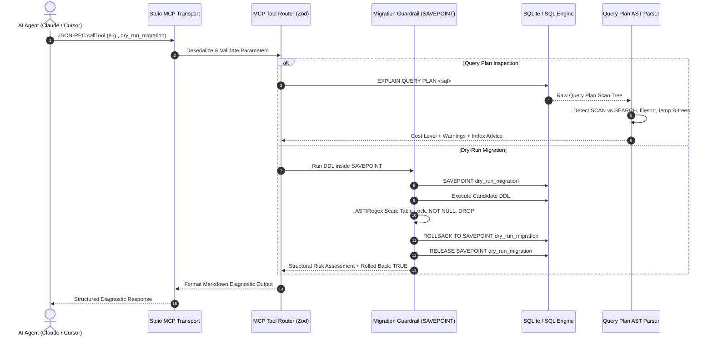

# 🛡️ Intelligent Database DBA & Schema Migration Guardrail MCP Server

[](https://www.typescriptlang.org/)
[](https://nodejs.org/)
[](https://modelcontextprotocol.io/)
[](https://sqlite.org/)
[](https://zod.dev/)
[](https://opensource.org/licenses/MIT)

An autonomous, production-grade **Database Administrator (DBA) MCP Server** built on the **Model Context Protocol (MCP)**. This server equips AI coding agents (such as Claude Desktop, Cursor IDE, Windsurf, and custom MCP clients) with database internals expertise: automated query plan AST decomposition, index coverage analysis, transactional isolation guardrails, and table-locking DDL risk detection.

---

## 🏗️ Architecture & Execution Flow

The server operates over standard I/O (`stdio`), strictly reserving `stdout` for clean JSON-RPC framing while routing operational logs to `stderr` and `server.log`.



---

## 🛠️ Core DBA MCP Tools

The server implements and registers 5 specialized DBA tools:

### 1. `explain_query_plan`
Executes `EXPLAIN QUERY PLAN` on arbitrary SQL queries, decomposes the scan tree, and flags performance bottlenecks such as unindexed Full Table Scans (`SCAN`), temporary B-trees (`USE TEMP B-TREE FOR ORDER BY`), and correlated subqueries.

- **Parameters (Zod):**
  - `sqlQuery` (`string`, required): The SQL SELECT query to analyze.
  - `tableName` (`string`, optional): Focus target table.
- **Diagnostics Flagged:**
  - `⚠️ FULL TABLE SCAN detected on table "orders" — no suitable index found`
  - `⚠️ Temporary B-Tree sort detected — ORDER BY without supporting index`
  - Cost rating: `LOW` | `MEDIUM` | `HIGH` | `CRITICAL`

### 2. `inspect_table_schema`
Performs comprehensive schema inspection including column nullability, default values, primary key constraints, foreign key cascades, and calculates quantitative index coverage percentages.

- **Parameters (Zod):**
  - `tableName` (`string`, required): The target table name.
- **Output Metrics:**
  - Column schema breakdown with types and constraints.
  - Foreign key dependency graph (`ON DELETE` / `ON UPDATE` rules).
  - Index coverage percentage (`% of columns covered`).
  - List of unindexed columns vulnerable to sequential scans.

### 3. `dry_run_migration`
Executes proposed DDL migrations inside an isolated transaction savepoint (`SAVEPOINT dry_run_migration`), evaluates table-locking risks, captures schema diffs, and **strictly rolls back** so database state is guaranteed unchanged.

- **Parameters (Zod):**
  - `migrationSql` (`string`, required): The DDL migration statement to dry-run.
- **Guardrail Policy Matrix:**
  | Pattern | Severity | Risk Explanation |
  |---------|----------|------------------|
  | `ALTER TABLE ... ADD COLUMN ... NOT NULL` (no default) | 🔴 CRITICAL | Fails immediately on populated tables |
  | `DROP TABLE` (without IF EXISTS) | 🔴 CRITICAL / 🟠 DANGEROUS | Irreversible data deletion |
  | `DROP COLUMN` | 🔴 CRITICAL | Irreversible data loss and application breakage |
  | `TRUNCATE TABLE` | 🔴 CRITICAL | Unlogged catastrophic row deletion |
  | `ALTER TABLE ... RENAME TO` | 🟡 WARNING | Breaks dependent views, triggers, queries |
  | `CREATE INDEX` (without IF NOT EXISTS) | 🟡 WARNING | Non-idempotent migration failure |

### 4. `suggest_optimal_indexes`
Parses query AST patterns across `WHERE` filtering clauses, multi-table `JOIN` keys, and `ORDER BY` sorting columns to synthesize precise, production-ready `CREATE INDEX IF NOT EXISTS` statements with logarithmic speedup rationale.

- **Parameters (Zod):**
  - `sqlQuery` (`string`, optional): SQL query to analyze.
  - `tableName` (`string`, optional): Table name for coverage-based recommendations.
- **Generates:**
  - Single-column B-tree index recommendations.
  - Composite multi-column indexes (e.g. `(user_id, status, created_at)`).
  - Foreign key join acceleration indexes.

### 5. `seed_demo_database`
Initializes high-volume relational benchmark tables (`users`, `orders`, `transactions`) with realistic multi-attribute relational data, intentionally unindexed to test and demonstrate the DBA analysis suite.

- **Parameters (Zod):**
  - `rowCount` (`number`, optional, default: 1000, range: 10–100,000): Number of seed records per table.

---

## 🚀 Quick Start & Installation

### Prerequisites
- Node.js 20+ installed
- npm or pnpm

### 1. Clone & Build
```bash
git clone https://github.com/thedailyhub31-blip/intelligent-db-dba-mcp-server.git
cd intelligent-db-dba-mcp-server
npm install
npm run build
```

### 2. Run the Automated Verification Suite
```bash
npm test
```
The test harness runs a 10-phase automated test connecting to the compiled server over stdio, seeding records, validating full table scan alarms, executing index suggestions, and confirming transactional rollback during critical DDL dry-runs.

---

## 🔌 AI Agent Integration

### Claude Desktop Configuration
Add the server entry to your Claude Desktop configuration file:
- **macOS:** `~/Library/Application Support/Claude/claude_desktop_config.json`
- **Windows:** `%APPDATA%\Claude\claude_desktop_config.json`

```json
{
  "mcpServers": {
    "intelligent-db-dba": {
      "command": "node",
      "args": [
        "/path/to/intelligent-db-dba-mcp-server/dist/src/index.js"
      ]
    }
  }
}
```

*(On Windows, provide the absolute path such as `C:\\Users\\<username>\\...\\dist\\src\\index.js`)*

### Cursor IDE Configuration
In Cursor Settings -> **Features** -> **MCP Servers** -> **Add New MCP Server**:
- **Name:** `intelligent-db-dba`
- **Type:** `command`
- **Command:** `node <absolute-path-to-repo>/dist/src/index.js`

---

## 🔒 Transaction Isolation & Guardrail Safety

The server guarantees zero database corruption through transactional invariants:
1. **Clean Stdio Framing:** Diagnostic logging strictly routes to `stderr` or `server.log`. `stdout` carries only RFC-compliant JSON-RPC protocol messages.
2. **Deterministic Rollback:** All dry-run migrations execute within a named savepoint block:
   ```sql
   SAVEPOINT dry_run_migration;
   -- execute candidate DDL
   ROLLBACK TO SAVEPOINT dry_run_migration;
   RELEASE SAVEPOINT dry_run_migration;
   ```
3. **Idempotent Guardrails:** Queries are parsed prior to migration execution to flag irreversible structural locks and destructive operations before they reach production clusters.

---

## 📄 License
This project is open-source software licensed under the [MIT License](LICENSE).
