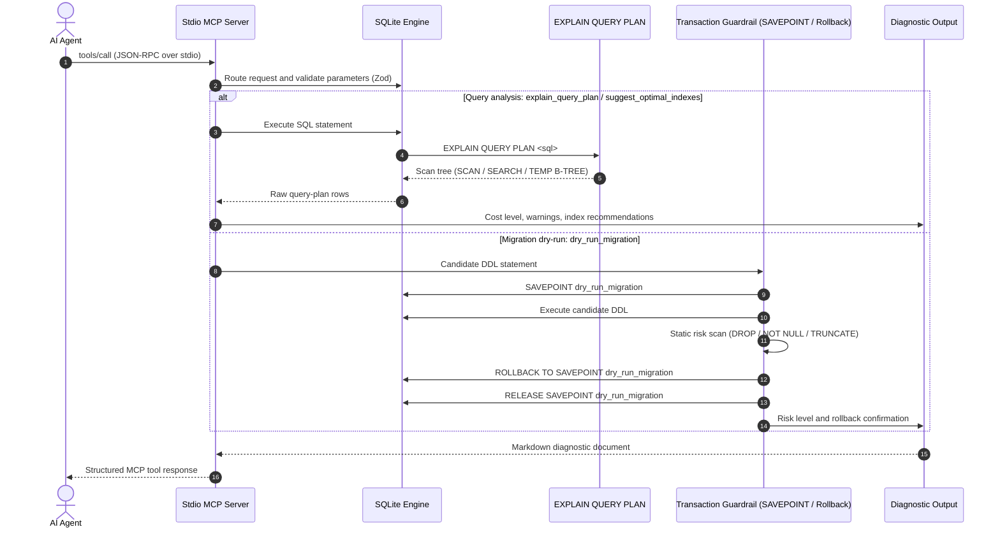

# Intelligent Database DBA & Schema Migration Guardrail MCP Server

[](https://www.typescriptlang.org/)
[](https://nodejs.org/)
[](https://sqlite.org/)
[](https://modelcontextprotocol.io/)
[](https://zod.dev/)
[](https://opensource.org/licenses/MIT)

An autonomous, production-grade **Database Administrator (DBA) MCP Server** built on the **Model Context Protocol (MCP)**. It gives AI coding agents (Claude Desktop, Cursor, Windsurf, and custom MCP clients) database-internals expertise: query-plan decomposition, index coverage analysis, transactional migration guardrails, and DDL risk detection.

---

## Architecture & Execution Flow

The server runs over standard I/O (`stdio`). `stdout` carries only JSON-RPC framing; operational logs go to `stderr` and `server.log`.



The SQLite engine is an in-memory `sql.js` database, so no database file is created. Every dry-run migration is executed inside a named savepoint and always rolled back.

---

## Core DBA MCP Tools

The server registers 5 tools. All responses are returned as MCP `text` content containing Markdown.

### 1. `explain_query_plan`

Executes `EXPLAIN QUERY PLAN` on a SQL query, decomposes the scan tree, and flags full table scans, temporary B-tree sorts, correlated subqueries, and missing indexes.

**Parameters**

| Name | Type | Required | Description |
|------|------|----------|-------------|
| `sqlQuery` | `string` | Yes | The SQL SELECT query to analyze. |
| `tableName` | `string` | No | Optional table to focus the analysis on. |

**Example input**

```json
{
  "sqlQuery": "SELECT * FROM orders WHERE user_id = 42 AND status = 'pending' ORDER BY created_at DESC"
}
```

**Example output**

```markdown
## Query Plan Analysis

**SQL:** `SELECT * FROM orders WHERE user_id = 42 AND status = 'pending' ORDER BY created_at DESC`
**Cost Level:** HIGH
**Full Table Scan Detected:** ❌ YES
**Index Scans Used:** ❌ NONE

### Raw EXPLAIN QUERY PLAN Output
```
  [3] parent=0 | SCAN orders
  [20] parent=0 | USE TEMP B-TREE FOR ORDER BY
```

### ⚠️ Warnings
- ⚠️ FULL TABLE SCAN detected on table "orders" — no suitable index found
- ⚠️ Temporary B-Tree sort detected — ORDER BY without supporting index

### 💡 Recommendations
- Consider adding an index on the WHERE/JOIN column(s) of table "orders"
- Add an index that covers the ORDER BY column(s) to avoid filesort

### 🚨 Tables Requiring Indexes
- **orders**: Run `suggest_optimal_indexes` with tableName="orders" for precise recommendations
```

---

### 2. `inspect_table_schema`

Returns column types, nullability, default values, primary keys, foreign keys, index details, and a quantitative index-coverage percentage.

**Parameters**

| Name | Type | Required | Description |
|------|------|----------|-------------|
| `tableName` | `string` | Yes | The name of the table to inspect. |

**Example input**

```json
{
  "tableName": "orders"
}
```

**Example output**

```markdown
## Table Schema: `orders`

**Columns (7):**
  id                       INTEGER          NULLABLE 🔑 PK
  user_id                  INTEGER          NOT NULL
  product_name             TEXT             NOT NULL
  amount                   REAL             NOT NULL
  status                   TEXT             NOT NULL  DEFAULT 'pending'
  created_at               TEXT             NOT NULL
  shipped_at               TEXT             NULLABLE

**Primary Key(s):** id

**Foreign Keys:**
  - user_id → users(id) ON DELETE NO ACTION

**Indexes (0):**
  (no indexes)

**Index Coverage:** 14% of columns indexed
**Unindexed Columns:** user_id, product_name, amount, status, created_at, shipped_at

> ⚠️ 6 unindexed columns detected — query performance may suffer without targeted indexes
```

---

### 3. `dry_run_migration`

Executes a DDL migration inside an isolated `SAVEPOINT dry_run_migration`, performs a static risk assessment, captures the resulting schema, and **always rolls back**. The database state is guaranteed to be unchanged.

**Parameters**

| Name | Type | Required | Description |
|------|------|----------|-------------|
| `migrationSql` | `string` | Yes | The DDL SQL statement to dry-run. It is fully rolled back. |

**Guardrail policy matrix**

| Pattern | Severity | Risk |
|---------|----------|------|
| `ALTER TABLE ... ADD COLUMN ... NOT NULL` without `DEFAULT` | 🔴 CRITICAL | Fails on populated tables |
| `ALTER TABLE ... DROP COLUMN` | 🔴 CRITICAL | Irreversible data loss |
| `DROP TABLE` | 🔴 CRITICAL | Irreversible data destruction |
| `TRUNCATE TABLE` | 🔴 CRITICAL | Unlogged row deletion |
| `DROP INDEX` | 🟠 DANGEROUS | Query performance regression |
| `DROP TABLE` without `IF EXISTS` | 🟠 DANGEROUS | May error when table is absent |
| `ALTER TABLE ... RENAME TO` | 🟡 WARNING | Breaks dependent views, triggers, queries |
| `CREATE INDEX` without `IF NOT EXISTS` | 🟡 WARNING | Non-idempotent migration |

**Example input**

```json
{
  "migrationSql": "ALTER TABLE orders ADD COLUMN priority_score INTEGER NOT NULL"
}
```

**Example output**

```markdown
## Dry-Run Migration Report

**Migration SQL:**
```sql
ALTER TABLE orders ADD COLUMN priority_score INTEGER NOT NULL
```

**Execution Result:** ❌ FAILED: Cannot add a NOT NULL column with default value NULL
**Transaction Rolled Back:** ✅ YES — database state unchanged
**Execution Time:** 2ms
**Risk Level:** 🔴 CRITICAL

### ⚠️ Detected Issues
- 🔴 Adding NOT NULL column without DEFAULT will fail on non-empty tables

### 💡 Guardrail Recommendations
- Add the column as nullable first, backfill data, then apply NOT NULL constraint

> 🚨 **CRITICAL RISK**: This migration has been blocked from production execution. Address all issues before applying.
```

A safe migration such as `ALTER TABLE orders ADD COLUMN discount REAL DEFAULT 0.0` returns `Risk Level: ✅ SAFE`, `Transaction Rolled Back: ✅ YES`, and executes successfully before being reverted.

---

### 4. `suggest_optimal_indexes`

Parses `WHERE` predicates, multi-table `JOIN` keys, and `ORDER BY` columns, then generates production-ready `CREATE INDEX IF NOT EXISTS` statements with performance rationale. At least one of `sqlQuery` or `tableName` must be provided.

**Parameters**

| Name | Type | Required | Description |
|------|------|----------|-------------|
| `sqlQuery` | `string` | Conditional | SQL query to analyze for index opportunities. |
| `tableName` | `string` | Conditional | Table name for coverage-based recommendations. |

**Example input**

```json
{
  "tableName": "orders"
}
```

**Example output**

```markdown
## Index Optimization Recommendations

### Suggested Indexes for `orders`
- **user_id**: `CREATE INDEX IF NOT EXISTS idx_orders_user_id ON orders (user_id);`
- **product_name**: `CREATE INDEX IF NOT EXISTS idx_orders_product_name ON orders (product_name);`
- **amount**: `CREATE INDEX IF NOT EXISTS idx_orders_amount ON orders (amount);`
- **status**: `CREATE INDEX IF NOT EXISTS idx_orders_status ON orders (status);`
- **created_at**: `CREATE INDEX IF NOT EXISTS idx_orders_created_at ON orders (created_at);`
- **shipped_at**: `CREATE INDEX IF NOT EXISTS idx_orders_shipped_at ON orders (shipped_at);`

---
**6 index(es) recommended.** Apply them in a migration and re-run `explain_query_plan` to verify improvement.
```

For a query input, the tool can additionally emit composite indexes (for example `(user_id, status, created_at)`) and JOIN-key indexes.

---

### 5. `seed_demo_database`

Initializes high-volume relational benchmark tables (`users`, `orders`, `transactions`) with realistic data that is intentionally unindexed, so the other DBA tools have a realistic workload to analyze.

**Parameters**

| Name | Type | Required | Description |
|------|------|----------|-------------|
| `rowCount` | `number` | No | Rows per table. Integer from `10` to `100000`. Default: `1000`. |

**Example input**

```json
{
  "rowCount": 1000
}
```

**Example output**

```markdown
## ✅ Demo Database Seeded Successfully

| Table | Rows | Indexes |
|-------|------|---------|
| users | 1000 | PRIMARY KEY only (intentionally unindexed) |
| orders | 3000 | PRIMARY KEY only (intentionally unindexed) |
| transactions | 2000 | PRIMARY KEY only (intentionally unindexed) |

**Next steps to test the DBA tools:**
1. Run `explain_query_plan` with `SELECT * FROM orders WHERE user_id = 42 AND status = 'pending'`
2. Run `suggest_optimal_indexes` with the same query
3. Run `dry_run_migration` with `ALTER TABLE orders ADD COLUMN discount REAL NOT NULL`
```

`orders` receives 3x `rowCount` rows and `transactions` receives 2x `rowCount` rows.

---

## Quick Start

### Prerequisites

- Node.js 20+
- npm 9+

### Install, build, and test

```bash
git clone https://github.com/thedailyhub31-blip/intelligent-db-dba-mcp-server.git
cd intelligent-db-dba-mcp-server
npm install
npm run build
npm test
```

The automated test harness connects to the compiled server over stdio and runs 10 checks:

1. Tool discovery
2. Demo database seeding
3. Table schema inspection
4. Full-table-scan detection
5. Index recommendations
6. Safe migration dry-run
7. Dangerous `NOT NULL` migration detection
8. Critical `DROP TABLE` detection
9. Rollback verification
10. Multi-table JOIN plan analysis

---

## AI Agent Integration

### Claude Desktop

Add the server to your Claude Desktop configuration:

- macOS: `~/Library/Application Support/Claude/claude_desktop_config.json`
- Windows: `%APPDATA%\Claude\claude_desktop_config.json`

```json
{
  "mcpServers": {
    "intelligent-db-dba": {
      "command": "node",
      "args": [
        "/absolute/path/to/intelligent-db-dba-mcp-server/dist/src/index.js"
      ]
    }
  }
}
```

On Windows, use an absolute path such as `C:\\Users\\<username>\\...\\dist\\src\\index.js`.

### Cursor

In **Settings → Features → MCP Servers → Add New MCP Server**:

- **Name:** `intelligent-db-dba`
- **Type:** `command`
- **Command:** `node <absolute-path-to-repo>/dist/src/index.js`

---

## Project Structure

```text
.
├── src/
│   ├── index.ts                  # MCP server, tool registration, request routing
│   ├── db/
│   │   ├── databaseEngine.ts     # sql.js engine, plan analysis, schema inspection
│   │   └── migrationGuardrail.ts # SAVEPOINT dry-runs and DDL risk assessment
│   ├── tools/
│   │   └── dbaTools.ts           # Zod schemas and tool handlers
│   └── utils/
│       └── logger.ts             # stderr + server.log logging
├── scripts/
│   └── test-client.ts            # 10-check MCP stdio test harness
├── package.json
├── tsconfig.json
├── LICENSE
└── README.md
```

---

## Transaction Isolation and Guardrail Safety

1. **Clean stdio framing** — diagnostics are written to `stderr` and `server.log`; `stdout` carries only JSON-RPC.
2. **Deterministic rollback** — every dry run is executed inside a named savepoint:
   ```sql
   SAVEPOINT dry_run_migration;
   -- execute candidate DDL
   ROLLBACK TO SAVEPOINT dry_run_migration;
   RELEASE SAVEPOINT dry_run_migration;
   ```
3. **Static risk scanning** — DDL is matched against destructive patterns before it is presented as safe.

---

## License

Released under the [MIT License](LICENSE).
